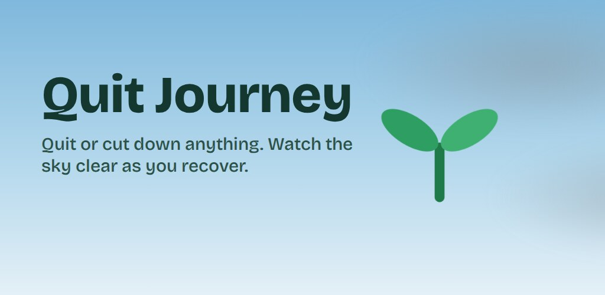
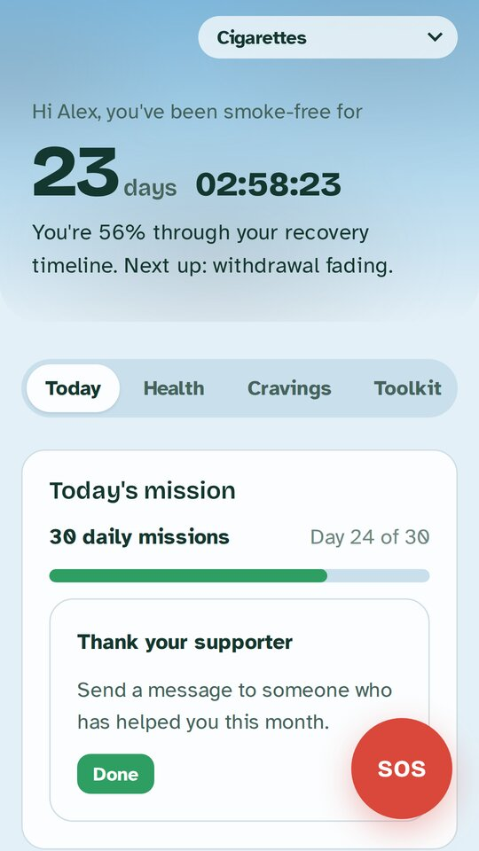
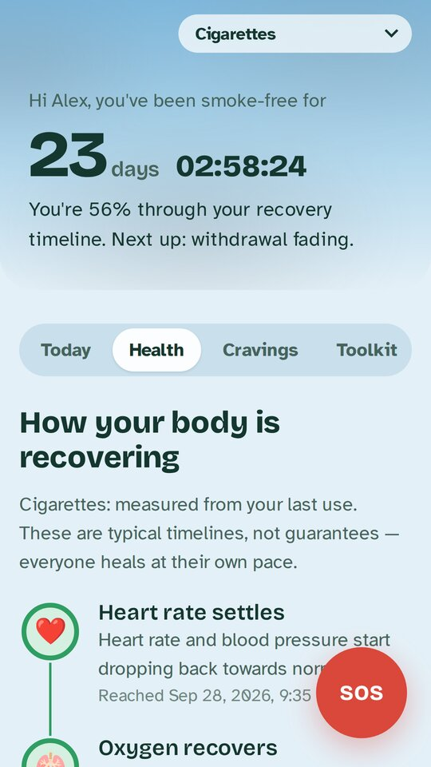
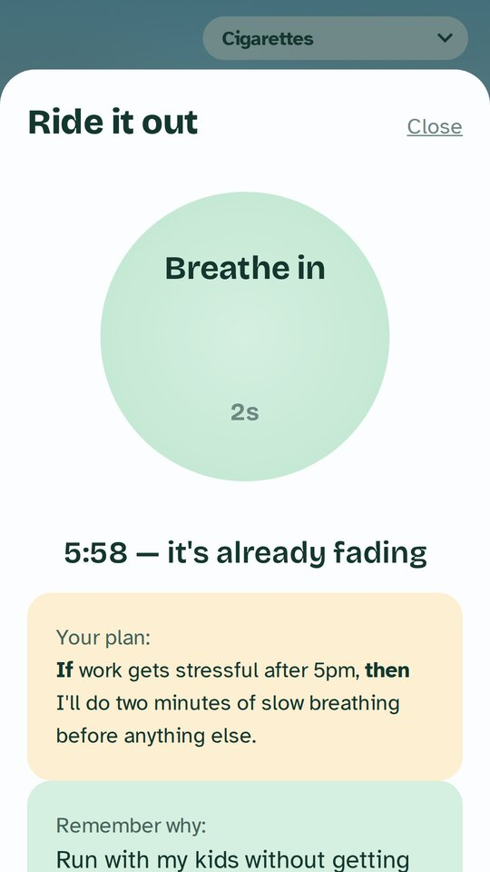
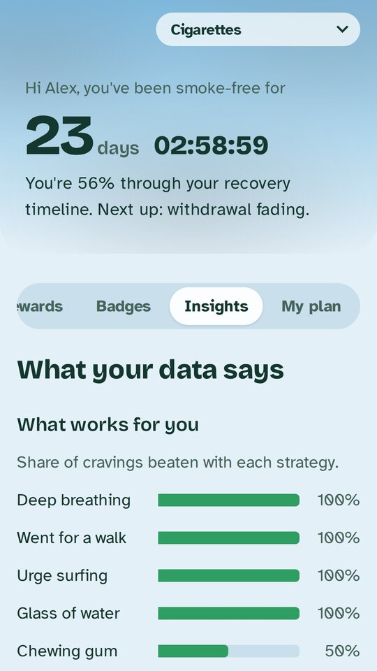
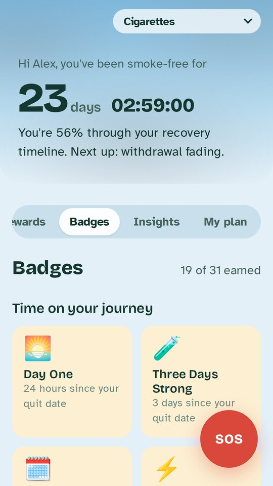
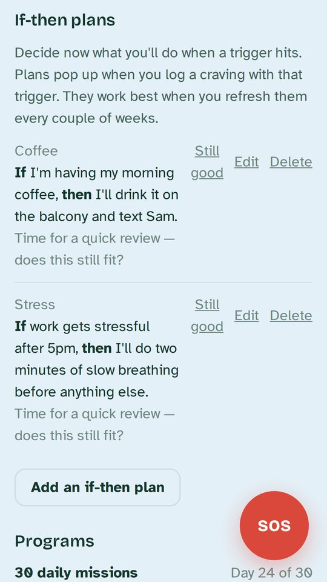
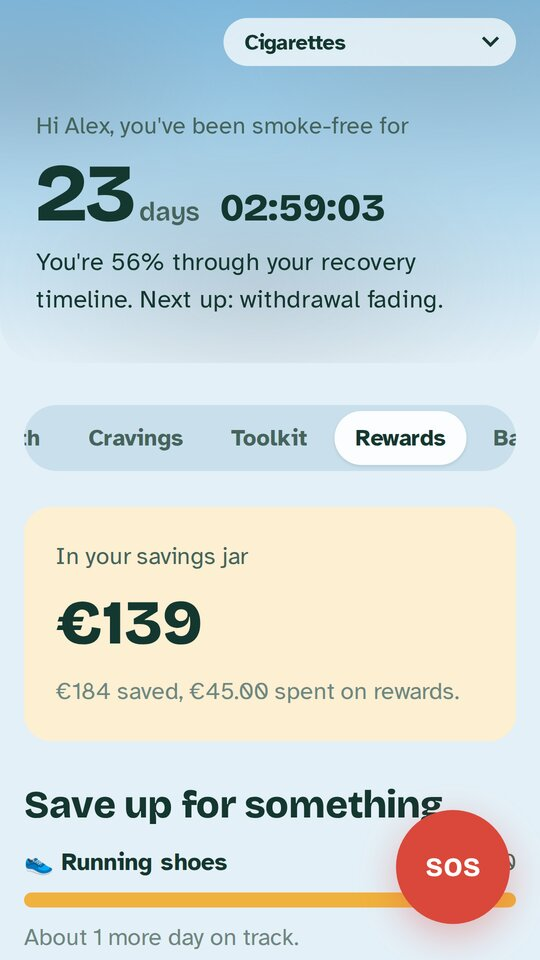

<p align="center">
  
</p>

<h1 align="center">Quit Journey</h1>

<p align="center">
  An open-source, offline-first companion for quitting smoking — and any other addiction.<br>
  Recovery timelines, cravings with personal coping insights, savings, missions and badges, in 41 languages.
</p>

<p align="center">
  
</p>

| Today                                                                                                   | Health                                                                                | SOS                                                                                                | Insights                                                                                                      |
| ------------------------------------------------------------------------------------------------------- | ------------------------------------------------------------------------------------- | -------------------------------------------------------------------------------------------------- | ------------------------------------------------------------------------------------------------------------- |
|  |  |  |  |

| Badges                                                                         | Toolkit                                                                        | Rewards                                                                                |
| ------------------------------------------------------------------------------ | ------------------------------------------------------------------------------ | -------------------------------------------------------------------------------------- |
|  |  |  |

> **Not medical advice.** Quit Journey is a self-help tool. It does not diagnose or treat any condition and is not a substitute for a doctor, pharmacist or addiction service. In an emergency call your local emergency number.

## What it does

- **Any addiction, one journey each:** nicotine (cigarettes, vapes, heated tobacco), alcohol, cannabis, opioids, stimulants and behavioural addictions such as gambling or screen time. Quit outright or cut down with a reduction plan.
- **Recovery timeline:** what is happening in your body, with sources, and how far along you are.
- **Cravings and slips:** log cravings with triggers and strategies; learn which strategies actually work for you and when you are most at risk. Slips are recorded without resetting your progress.
- **SOS:** breathing exercise, urge surfing, your own reasons and a one-tap message to a support contact.
- **Toolkit:** if-then plans, risky places, daily check-ins with validated scales, medication schedules, structured programs, harm reduction (naloxone, drug checking, safety timer) and a meeting finder.
- **Motivation:** money saved, reward goals, daily missions, XP, levels and badges.
- **Privacy:** no account, no server, no tracking. Data stays on the device; optional PIN lock, screenshot blocking and a disguised launcher icon.
- **41 languages** via react-intl (ICU). Non-English catalogs are machine-translated — corrections are very welcome.

## How it is built

Quit Journey is a [Powerhouse](https://www.powerhouse.inc) reactor package. The journey is a document (`w3b/quit-journey`, `.quit`) whose state changes only through pure, tested reducer operations, so the same document can live in a Powerhouse drive, sync between devices, or run fully offline in the phone app.

```
document-models/quit-journey/   document model: GraphQL schema, reducers, tests
  v1/src/engine/                pure logic: substances, health, money, gamification, insights, toolkit
editors/quit-journey-editor/    shared React UI (QuitJourneyApp) used by Connect and the app
  i18n/                         locale catalogs and tooling (see i18n/README.md)
mobile/                         Android app (Capacitor 8), see mobile/README.md
```

## Getting started

Tested with Node.js 24.

```bash
npm install
npm run vetra          # local Connect + Switchboard; open the printed Connect URL
npm test               # reducer and engine tests
npm run tsc && npm run lint
```

Phone app:

```bash
cd mobile
npm install
npm run dev            # browser preview at http://localhost:5173
npm run apk:debug      # needs the Android SDK, see mobile/README.md
```

The document model is edited through Vetra/reactor-mcp and then code-generated; never edit files under `gen/`. Schema changes must stay backward compatible (optional fields, new enum values) so existing journeys keep working. `CLAUDE.md` describes the full workflow.

## Contributing

Issues and pull requests are welcome — especially translation fixes, recovery content with sources, and accessibility improvements. See [CONTRIBUTING.md](CONTRIBUTING.md). Security issues: see [SECURITY.md](SECURITY.md).

## License

[AGPL-3.0-only](LICENSE) © W3B (web3-berlin). The name "Quit Journey" and the app icon are not covered by the license; forks published to app stores should use their own name and icon.
